# PPO Control of a Real Inverted Pendulum (Sim-to-Real)

Master's project at the National University of Singapore (2025–2026).
**Question: is a deep RL policy more robust than classical control on a real pendulum, and what does it take?**
Continuous-action PPO policies are compared with the LQR supplied with a commercial Acrome cart–pole pendulum,
on the real hardware (Raspberry Pi, 250 Hz, Simulink + Embedded Coder).

[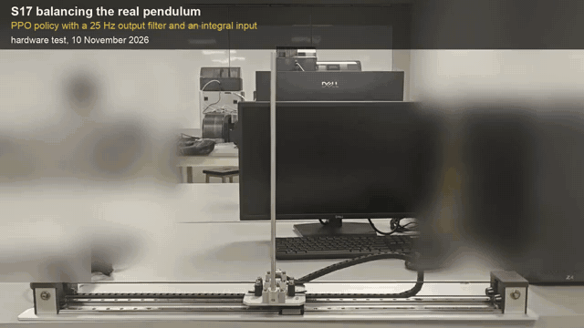](media/videos/defense_reel.mp4)
*Hardware, 10 November 2026: the same programmed push, centring under a deliberate sensor offset, and a policy that was best in the original simulator oscillating on the hardware. Click for the [3-minute video with sound](media/videos/defense_reel.mp4).*

**In short**

- **Margin:** in the same runs as the supplied LQR, the policies S13b and S17 had a lower peak sensitivity in every calibrated run (4.3–4.9 against at least 6.4). Confirmed on the hardware, against a prediction written before the test.
- **Centring under a sensor offset:** S17 stayed within 2 mm of the centre under offsets of ±20 mrad, where the LQR sat 72–86 mm away. This comes from an integral input added by hand, not from the network.
- **Smoothness:** only about 10 % better and only qualitative. **Cart motion:** 14–25 % worse than the LQR.
- **What it took:** a simulator calibrated against the hardware. Policies trained in the original simulator failed on the hardware, and the one that ranked first in it oscillated.
  RL was not model-free in practice: the simulator decided what it learned.
- One seed, one day of tests: not a statistical result.

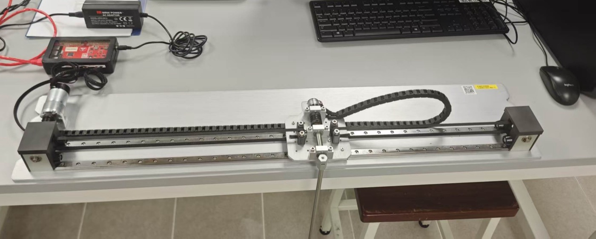

## Latest hardware test: RL against the supplied LQR in the same run (10 November 2026)

The supplied LQR block, S13b and S17 alternated within each run (150 s each, twice), with programmed pushes
(500 PWM × 0.1 s) and stepped-sine probes at 150 and 75 PWM. Four runs had the angle zero calibrated and two had it
offset by about ∓20 mrad on purpose. The predictions and decision rules were written before the data. Nothing fell in any run.

S13b is the S12 policy trained further with a 25 Hz output low-pass filter. S17 adds an integral of the cart position
as an input, pushes during training and gain targets chosen from scans (training scripts S13b → S17 in `training/`).
The filter and the integral are structure added by hand: RL tuned the gains around them.

| Four calibrated runs, ranges | Supplied LQR | S13b | S17 |
|---|---|---|---|
| Peak sensitivity \|S\| at 150 PWM | ≥ 6.42–6.90 (lower bound: command at the limit 24–29 % of the time) | 4.33–4.71 | 4.32–4.86 |
| Peak \|S\| at 75 PWM | 6.61–10.32 | 3.90–5.58 | 5.48–6.51 |
| Step-to-step command change (ΔPWM RMS) | 23.3–27.2 | 18.4–20.5 | 20.7–23.6 |
| Cart standard deviation | 11.3–14.9 mm | 16.1–25.4 mm | 13.0–16.7 mm |
| Recovery from a push (median of 24) | 1.54 s | 0.76 s | 0.88 s |
| Mean cart position, reading offset −20 mrad | −72, −79 mm | −125, −128 mm | **+0.1, +0.2 mm** |
| Mean cart position, reading offset +20 mrad | +86, +85 mm | +142, +137 mm | **−0.3, −1.2 mm** |

- **Confirmed:** both policies have a lower peak sensitivity than the supplied LQR in every calibrated run (margin), and
  S17 returns to the centre under an offset of either sign, which the block and S13b cannot (centring; the integral input does this).
- **Only qualitative:** S17's command is about 10 % smoother, but in no run did both controllers pass the drift rule
  (a controller must change by less than 10 % between its two segments in a run). S13b is 19–20 % smoother in the two runs that passed.
- **Not won:** S17's cart moves 14–25 % more than the block's, and its sensitivity rises at smaller probe amplitudes (×1.27–1.37 from 150 to 75 PWM), as predicted.
- One seed, one day, four calibrated runs: not a statistical result.

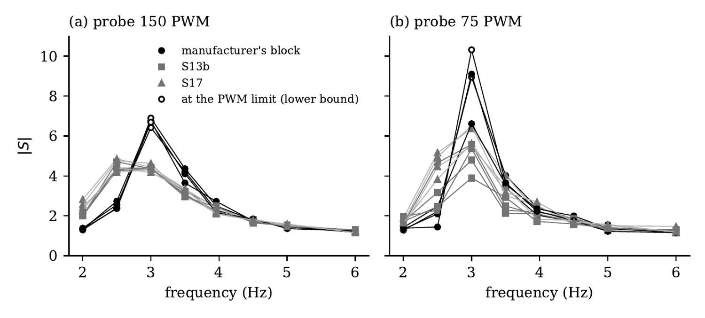

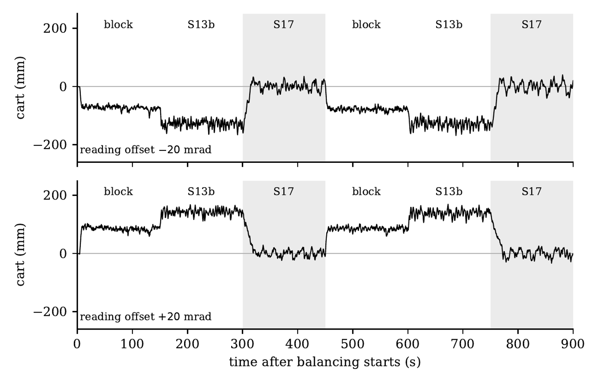
*Cart position after a 0.2 Hz low-pass filter; shaded: S17. Block and S13b stay off centre, S17 returns to the centre each time it takes over.*

### Videos (hardware, 10 November 2026)

Short clips with data overlays; the background is blurred. Click a picture to open the video.

| | |
|---|---|
| [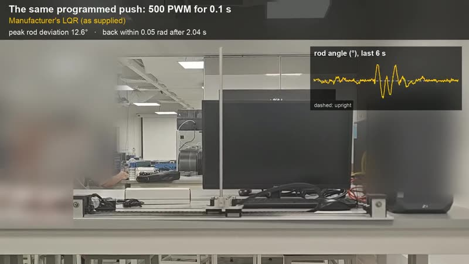](media/videos/C2_same_push.mp4) | [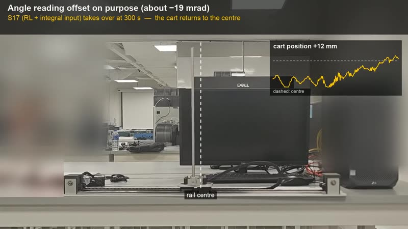](media/videos/C3_centring.mp4) |
| **Same programmed push** for each controller, real time and 0.5× replay ([C2_same_push.mp4](media/videos/C2_same_push.mp4)) | **Centring under a −19 mrad offset**: block, S13b, then S17 taking over; the centre line is computed from the logged cart position ([C3_centring.mp4](media/videos/C3_centring.mp4)) |
| [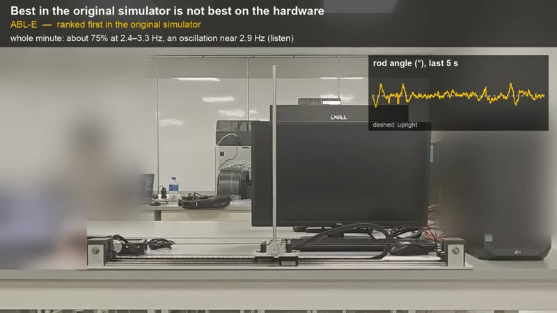](media/videos/C5_S8_vs_E.mp4) | [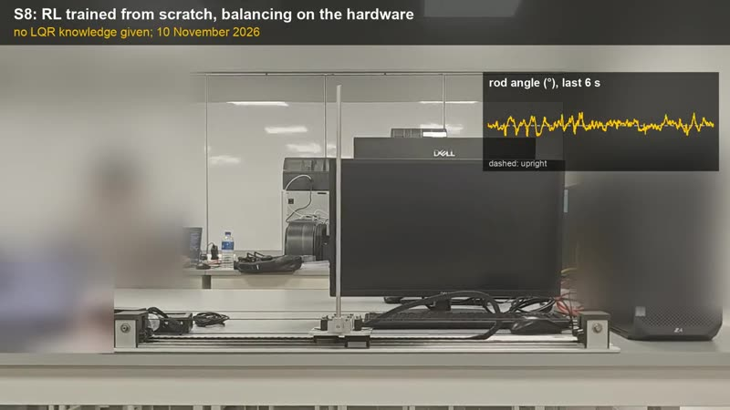](media/videos/C6_S8.mp4) |
| **S8 against ABL-E**: the variant that ranked first in the original simulator oscillates near 2.9 Hz on the hardware; sound on ([C5_S8_vs_E.mp4](media/videos/C5_S8_vs_E.mp4)) | **S8 at rest**: trained from scratch ([C6_S8.mp4](media/videos/C6_S8.mp4)) |

Also: [opening clip](media/videos/C1_opening.mp4), [light hand pushes](media/videos/C4_hand_push.mp4) (demonstration only), and the [3-minute reel](media/videos/defense_reel.mp4).

## Earlier results: S8 and S12 (September–October 2026)

Last 45 s of steady balancing, injection segments removed.

| Controller | θ std | θ peak | PWM std |
|---|---|---|---|
| PPO policy trained from scratch (S8) | 0.98° | **4.1°** | 114 |
| Network clone of the LQR, gains × 0.85 (best linear controller tested) | 0.99° | 6.1° | 119 |
| Manufacturer's LQR block (recorded on another day) | 1.39° | 6.1° | 132 |

- The policy trained from scratch reached the level of the best linear controller tested, with the lowest peak angle.
  Recorded on the same day as the manufacturer's LQR, it balanced about equally well and had a lower peak sensitivity.
- A policy retrained in a calibrated simulator (S12) kept a larger stability margin on the hardware, as predicted
  before the test: closed-loop sensitivity |S| at 2.5 Hz was 3.3–3.4, against 5.6–5.7 for S8.
- A slow integral outer loop removed the cart offset caused by the drifting angle-sensor zero (−124 mm → −3 mm).

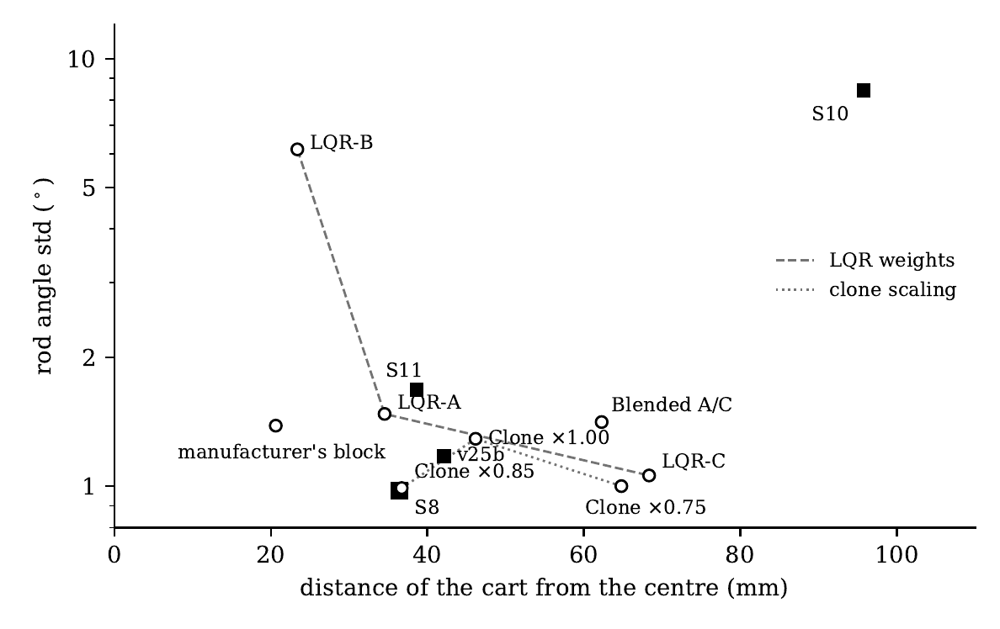
*Rod angle jitter against cart offset on the hardware. Squares: RL policies; circles: linear controllers.*

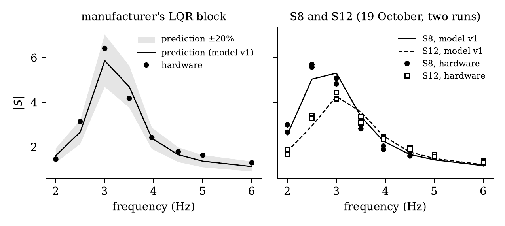
*Left: sensitivity of the manufacturer's LQR predicted by the calibrated simulator before the test, with the hardware points.
Right: S8 and S12 on the hardware (two runs) against the simulator.*

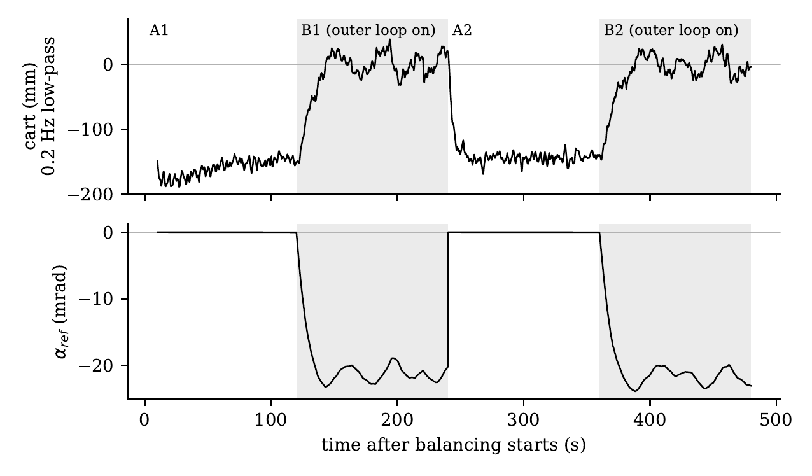
*Outer loop switched on (B) and off (A): the cart returns to the centre as the reference angle settles at the sensor zero.*

## What was hard

- **Policies that balanced perfectly in simulation failed on the hardware.** A network trained to imitate the LQR,
  run through the same deployment path, showed that deployment worked and the simulator did not.
- **Two interface errors in the velocity signals** (wrong sign on the cart velocity, wrong unit scaling on the angular
  velocity), and the bandwidth of the velocity estimates turned out to decide whether a policy could run at all.
- **Closed-loop system identification** with a stepped-sine probe showed the simulator lacked 40–90° of phase lag.
  With friction and inertia measured in open-loop tests, the calibrated simulator predicted the manufacturer's LQR
  sensitivity at eight frequencies within 20 %, before the data were recorded.

  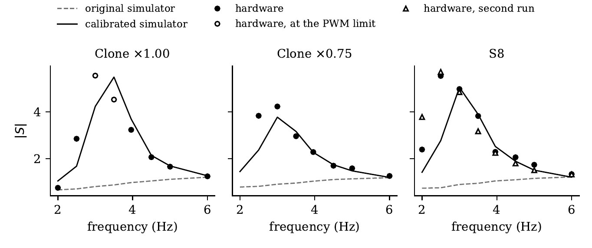
- **Hinge constraints on the actor loss** encode the properties exposed by each failed hardware test (gain at the
  oscillation frequency, far-field thrust, channel signs, velocity gain), because they are properties of the network
  function and cannot be written as per-step rewards.
- **Pre-flight checks before every hardware run**, evaluated on the states the policy actually visits.
- **Predictions and decision rules written before each hardware session**, including a drift rule that decides whether a comparison may be called quantitative.

## Repository layout

| Folder | Contents |
|---|---|
| `training/` | PPO training: `train_rl_scratch_S8.m` (best hardware policy), `train_rl_S12.m` (calibrated simulator + domain randomisation), `train_rl_S13b.m` … `train_rl_S17.m` (one change at a time: output filter, integral input, pushes in training, gain targets), `train_lqr_clone.m`, `train_rl_ABL.m` (reward ablation), `train_rl_EST.m` (estimator bandwidth test) |
| `calibrated_sim/` | Calibrated simulator (`v1_*.m` for MATLAB training, `sim_model_v1.py` for Python), plant identification from probe data |
| `deployment/` | Simulink model `PendulumQuickStart_RL.slx` and the controller functions pasted into its `RL_Controller` block (`fcn_S8S12_ABAB.m`: S8/S12 A/B test with outer loop and probe; `fcn_S8_OL.m`: outer-loop centring; `fcn_LQR_static.m`; `fcn_LQRS13S17.m`: supplied block, S13b and S17 in the same run with pushes and probes; `fcn_demo_all.m`: hand-push and S8 / ABL-E demonstration; `lqrs13s17_sim.m`: dry run of that program in the calibrated simulator) |
| `preflight/` | Checks run before any network goes on the hardware (`s12_pre.m`, `s13b_pre.m` … `s17_pre.m`, `s17_verify.m` re-check on new seeds) |
| `analysis/` | Hardware data analysis (`s17_hw_analyze.py`, `s17_hw_verdict.py` for the 10 November runs), LQR weight scan, velocity-chain check |
| `prototypes/` | My early hand-written RL code: REINFORCE → A2C → n-step A2C → PPO → continuous PPO with squashed Gaussian, plus a SAC cross-check |
| `models/` | Trained networks (`actor_net_S8_deploy.mat`, `actor_net_S12_deploy.mat`, `actor_net_S13b_deploy.mat`, `actor_net_S17_deploy.mat`, LQR clone) |
| `media/` | Figures and the short hardware videos |

Policy: actor 4→64→64→2, critic 4→64→64→1, squashed Gaussian; GAE (γ 0.99, λ 0.95), clip 0.2.
State `[x, v/5, α, ω/10]`, action `pwm = 1000·tanh(μ)`.

## Notes

- Raw hardware recordings are not included, so the analysis scripts show the method but will not run as is.
- To deploy: open the model, paste one of the `deployment/fcn_*.m` functions into `RL_Controller`, put the network
  `.mat` next to the model, and set your own Raspberry Pi address and login in Hardware Settings
  (they have been cleared from this copy). The block currently holds the code of an earlier experiment. The S13b/S17 programs
  (`fcn_LQRS13S17.m`, `fcn_demo_all.m`) have five inputs: the command of the supplied LQR block must be wired to the fifth, as it was in the November tests.
- `PendulumQuickStart_RL.slx` is derived from the manufacturer's example model for the Acrome pendulum.
- Requires MATLAB R2025a with Deep Learning Toolbox, Simulink, Embedded Coder and the Raspberry Pi support package;
  Python scripts need NumPy, SciPy, pandas and Matplotlib.
